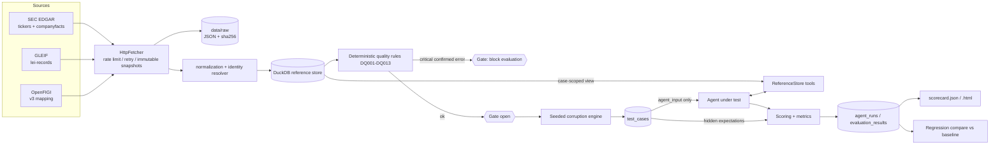

# Architecture

## Responsibility split
| Package | Responsibility |
|---|---|
| `common` | config, DuckDB schema, immutable-snapshot HTTP fetcher, logging, ids |
| `ingestion` | one adapter per source (+ loaders, CLI) |
| `normalization` | SEC → observations; unit-conversion layer (storage never converts units) |
| `identity` | name matching as candidate generation, with explicit ambiguity |
| `quality` | 13 deterministic rules, confirmed-error vs needs-review, evaluation gate |
| `corruption` | reversible transforms, seeded case generator (no changes to golden data) |
| `agent` | schemas, case-scoped tools, mock agents, optional LLM adapter + cache |
| `evaluation` | pure scoring/metrics, runner (records run metadata) |
| `reporting` / `regression` | scorecards; baseline diff with per-category thresholds |

## Leakage control
`test_cases.agent_input` (records only) is the sole thing passed to an agent. `expected` and `store_overrides`
(which hide periods from the case-scoped store) are read only by the evaluator. Case ids are hashed and sorted so
category cannot be inferred from id or position.
